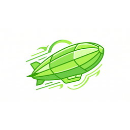
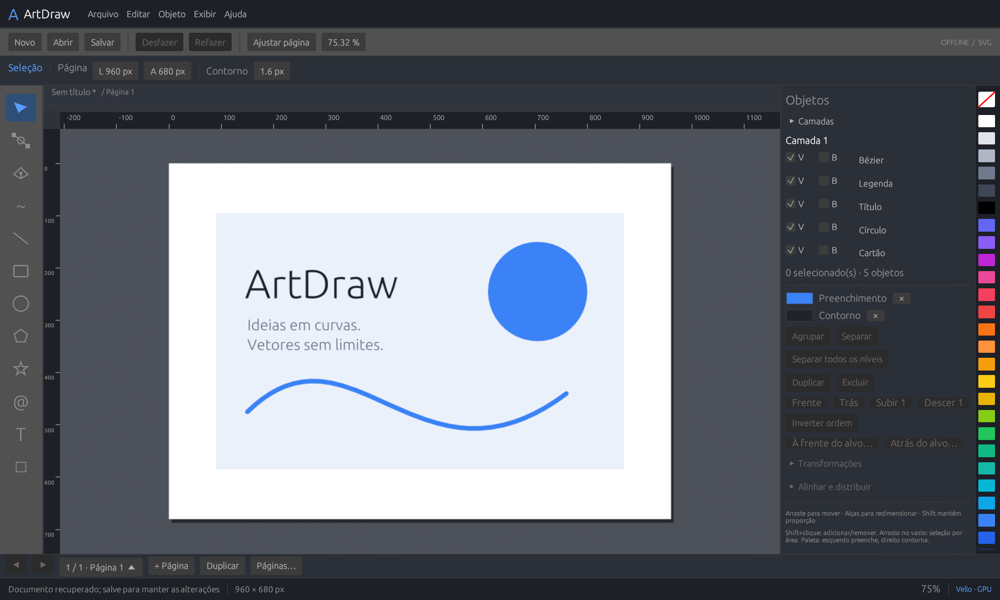
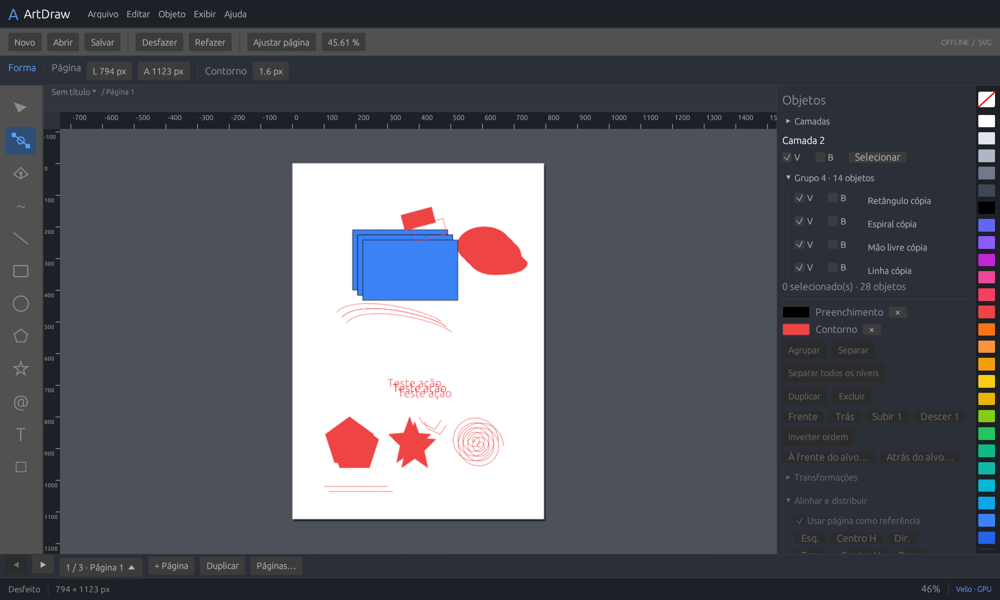

<p align="center"></p>

# ArtDraw

**Um editor vetorial livre para Windows — e um estudo aberto de como construí-lo.**

O ArtDraw nasceu da vontade de entender e desenvolver as ferramentas de um editor vetorial profissional: curvas, nós, páginas, tipografia, cores e arquivos que continuem editáveis. A referência de comportamento é o CorelDRAW para Windows; a implementação é independente, em Rust, com código próprio e dependências abertas.

**Estamos no começo.** Já existe uma aplicação que desenha, salva e roda offline. Ainda falta a maior parte do caminho até a fidelidade desejada. Abrimos o código para transformar esse esforço em uma construção comunitária: você pode ajudar com programação, testes, design, documentação ou uma boa descrição do que falta.

[Baixar a versão experimental](https://github.com/caio-vinicius-dmc/ArtDraw/releases/tag/v1.9.0) · [Como colaborar](CONTRIBUTING.md) · [Estudo de engenharia](docs/CORELDRAW_PARITY.md) · [Lista do que falta](docs/CORELDRAW_GAP_LEDGER.md) · [Licença MIT](LICENSE)



*Captura real da versão 1.9.0, com um desenho próprio de exemplo. A interface e seus fluxos ainda estão em desenvolvimento.*

## Onde estamos — sem maquiar os números

<!-- parity:start -->
| Medida | Estado atual |
| --- | ---: |
| Indicador interno de maturidade | **11,6%** |
| Restante no indicador (não é estimativa de esforço) | **88,4%** |
| Capacidades inventariadas | 363 em 22 famílias |
| Itens pendentes / implementados a validar / escopo a confirmar | 259 / 3 / 3 |
| Equivalência comparativa comprovada | **0** |
| Itens do alvo offline ainda sem equivalência comprovada | **362 de 362** |
<!-- parity:end -->

O indicador mede a maturidade do **inventário conhecido**, com pesos fixos. **Não é um percentual certificado de equivalência ao CorelDRAW**, nem uma estimativa de esforço ou prazo. O inventário pode crescer; todos os recursos sem comparação continuam com lacunas, inclusive os que já funcionam. [Cálculo e critérios](docs/VALIDATION_PROTOCOL.md) · [Estado completo](docs/PARITY_STATUS.md).

A meta de longo prazo é aproximar funções, comportamento, UI/UX, temas e preservação de documentos. **Ainda não há leitura nem escrita de CDR**, e nenhuma versão desse formato foi homologada. SVG/PDF não substituem a troca CDR sem perdas. [Plano específico de interoperabilidade](docs/CDR_INTEROPERABILITY.md).

## O que já dá para experimentar

| Área | Implementado em algum nível | O que ainda falta |
| --- | --- | --- |
| Desenho | Retângulo, elipse, linha, polígonos, estrelas, espiral, traço livre e caneta Bézier | Parametrização completa, suavização e ferramentas avançadas |
| Edição | Seleção múltipla, mover/escala, alinhamento, distribuição, nós e alças com F10 | Booleanos, offsets robustos, mais tipos de nó e controles |
| Organização | Páginas independentes, camadas, grupos aninhados, ordem e posicionar por alvo | Mestras, reparentamento, ordenação interna e seleção progressiva |
| Aparência e texto | Fill/stroke/alpha uniformes, texto simples e quatro temas próprios | Degradês/malhas, fontes do sistema, shaping, parágrafos e ICC/CMYK |
| Arquivos | Nativo .artdraw versionado, backup/recuperação, importação/exportação SVG e PDF vetorial básico | CDR, raster, formatos profissionais e preservação integral entre aplicativos |
| Interface e GPU | egui, Vello/wgpu, canvas com zoom/pan, réguas e paleta | Acessibilidade, personalização, benchmarks e fidelidade visual/comportamental comparada |

Na 1.9.0, a novidade é **colocar a seleção à frente ou atrás de um alvo escolhido por clique**, com cancelamento, transferência de camada e undo/redo. Grupos/folhas e documentos legados têm restrições. [Detalhes e limites](docs/STACKING_ORDER.md) · [Histórico de versões](CHANGELOG.md).

<details>
<summary>Ver outra captura: edição, grupos e formas em um cenário de testes</summary>



Esta imagem vem do roteiro automatizado com GPU da aplicação; é uma cena de validação, não um mockup nem uma promessa de recursos futuros.

</details>

## Baixar e usar

**Versão disponível: 1.9.0 experimental, Windows 10/11 x64.** Requer GPU/driver com suporte a DirectX 12 ou Vulkan e compute shaders. A execução do editor é offline; o download e a preparação inicial do ambiente de desenvolvimento precisam de internet.

### Portátil — opção recomendada para conhecer o projeto

1. Baixe [ArtDraw-Portable.zip](https://github.com/caio-vinicius-dmc/ArtDraw/releases/download/v1.9.0/ArtDraw-Portable.zip).
2. Extraia o ZIP em uma pasta gravável.
3. Execute **coreldraw_clone.exe**. Esse é o nome técnico atual do binário; a aplicação se chama ArtDraw.

Não é necessário registrar uma instalação. Os binários ficam nos [Releases](https://github.com/caio-vinicius-dmc/ArtDraw/releases/tag/v1.9.0), fora do histórico Git. O ZIP automático de código-fonte do GitHub não contém o executável.

### Instalador Windows

Baixe [ArtDraw-Setup.exe](https://github.com/caio-vinicius-dmc/ArtDraw/releases/download/v1.9.0/ArtDraw-Setup.exe). O assistente apresenta a marca, licença, escolha de diretório, atalhos e progresso. Por padrão, instala para o usuário em %LOCALAPPDATA%\Programs\ArtDraw.

**Limitação conhecida da distribuição:** os binários ainda não têm assinatura Authenticode. Em uma homologação, o Windows App Control bloqueou o desinstalador sem assinatura. A cópia do pacote e a execução passaram, mas o ciclo completo de instalação/desinstalação permanece parcialmente homologado. Prefira o portátil para avaliar. Não desative proteções do Windows para executar o projeto. [Registro e próximo trabalho](docs/WINDOWS_DISTRIBUTION.md).

Confira os downloads com [SHA256SUMS.txt](https://github.com/caio-vinicius-dmc/ArtDraw/releases/download/v1.9.0/SHA256SUMS.txt):

```powershell
Get-FileHash .\ArtDraw-Portable.zip -Algorithm SHA256
```

### Primeiros passos

- Retângulo: **F6**; elipse: **F7**; caneta: **P**; texto: **F8**; seleção: **V**; editar nós: **F10**.
- Arraste na página para desenhar. Shift restringe proporções/eixos; Ctrl + roda aproxima/afasta; Espaço + arrasto navega.
- Na paleta: clique esquerdo aplica preenchimento; direito aplica contorno.
- Salve em **.artdraw** para preservar o documento do aplicativo. A exportação SVG usa a página ativa; o PDF básico usa documento/página, RGB e texto em curvas.
- Desfazer/refazer: Ctrl+Z / Ctrl+Y. Trabalhe com cópias dos seus arquivos durante esta fase experimental.

[Guia de uso, formatos e atalhos](docs/USAGE.md).

## O estudo de engenharia

O desafio vai além de desenhar uma barra de ferramentas. Cada capacidade precisa atravessar **gesto → modelo → histórico → renderização → salvar/reabrir**, com cancelamento e falhas que preservem o documento.

| Parte | Decisão atual | Onde estudar |
| --- | --- | --- |
| Modelo | Páginas e objetos com IDs; hierarquia de grupos e transformações afins | [document.rs](src/document.rs), [editing.rs](src/editing.rs), [GROUP_HIERARCHY.md](docs/GROUP_HIERARCHY.md) |
| Geometria | Bézier cúbica, De Casteljau, limites/hit-test e controle de nós | [interaction.rs](src/app/interaction.rs), [memória de arquitetura](ARCHITECTURE_MEMORY.md) |
| Renderização/UI | Rust + egui + Vello/wgpu; textura GPU e cache da página ativa | [render.rs](src/render.rs), [app.rs](src/app.rs) |
| Persistência | XML nativo v3, leitura v1/v2, validação, gravação atômica e backup | [storage.rs](src/storage.rs), [recovery.rs](src/recovery.rs) |
| Interoperabilidade | SVG e PDF básico; leitor e gravador CDR como trilhas separadas | [svg.rs](src/svg.rs), [pdf.rs](src/pdf.rs), [plano CDR](docs/CDR_INTEROPERABILITY.md) |
| Evidência | Matriz de recursos, corpus próprio e critérios visuais/semânticos | [protocolo](docs/VALIDATION_PROTOCOL.md), [VALIDATION.md](VALIDATION.md) |

A versão 1.9.0 passou em **93 testes unitários, 139 verificações de interação com GPU e 3 de recuperação**, além de ensaios na janela real e conferência de arquivos salvos. Isso valida o subconjunto testado; não demonstra equivalência com o original. O CI verifica compilação e testes sem GPU em um clone Windows limpo; não homologa UI, DPI, GPU ou instalador.

A abordagem é **clean-room**: estudar documentação pública e comportamento observável, formular critérios e escrever código próprio. Não publicar código, ícones, fontes comerciais ou documentos proprietários sem autorização. ArtDraw é um projeto independente, sem afiliação ou endosso da Corel; CorelDRAW é marca de seus respectivos titulares.

## Compilar e colaborar

Instale Git, Rust estável x64 MSVC e Visual Studio Build Tools com **Desktop development with C++** e Windows SDK. O código e os assets necessários estão neste repositório; a pasta local .tools não é necessária no caminho padrão.

```powershell
git clone https://github.com/caio-vinicius-dmc/ArtDraw.git
cd ArtDraw
cargo fetch --locked
.\build.ps1 -Mode All -Offline
.\target\release\coreldraw_clone.exe
```

[Compilação detalhada, GNU e empacotamento](docs/BUILDING.md) · [Guia de contribuição](CONTRIBUTING.md) · [Verificações Windows](https://github.com/caio-vinicius-dmc/ArtDraw/actions/workflows/windows.yml).

Não precisa saber Rust para participar. Um arquivo próprio que reproduz um erro, uma captura bem explicada, uma melhoria de texto ou um estudo de fluxo já ajudam. Se você programa, comece por uma lacuna pequena e entregue o caminho completo, com evidência e limites registrados.

- **Testes e UX:** reproduzir fluxos, relatar foco/atalhos/cancelamento e comparar comportamento com versão identificada.
- **Geometria e formatos:** curvas, topologia, SVG, CDR e corpus autorizado com relatório de perdas.
- **Rust e GPU:** estrutura de comandos, desempenho, recuperação e renderização.
- **Design e documentação:** clareza da interface, acessibilidade, tutoriais e organização do estudo.

[Abra uma issue](https://github.com/caio-vinicius-dmc/ArtDraw/issues/new/choose) ou [envie uma pull request](https://github.com/caio-vinicius-dmc/ArtDraw/compare). Consulte o [roteiro de desenvolvimento](docs/ROADMAP.md) e os IDs da [matriz](docs/FEATURE_MATRIX.csv) antes de iniciar recursos maiores. Este projeto ainda é pequeno: não há promessa de prazo ou de suporte profissional. A ideia é aprender, construir e tornar o avanço verificável, uma contribuição de cada vez.

Código original sob [MIT](LICENSE). Dependências e fontes mantêm suas licenças; os pacotes de distribuição incluem os avisos correspondentes.
